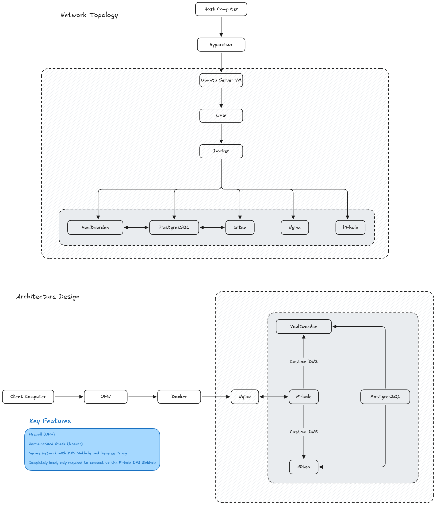

# ☁️ Mission 10: The Enterprise Cloud Architect

## 📌 Project Overview

This project serves as the final mission for CCM101 – Cloud Computing. It showcases the planning, configuration, deployment, security, automation, and documentation of a multi-tier application running on an Ubuntu Server virtual machine.

The system utilizes Docker and Docker Compose to manage and connect multiple application services. It also implements persistent database storage to ensure that important data remains intact even after restarting the virtual machine.

For server protection, UFW (Uncomplicated Firewall) is configured to control incoming network traffic. Additionally, a Bash automation script is developed and scheduled through Cron to perform routine administrative tasks, such as database backups and system health monitoring.

Through this project, the concepts and practical skills learned throughout the Cloud Computing laboratory activities are brought together in a single deployment.

## 🎯 Project Objectives

- 🏗️ Plan and document the cloud infrastructure and network architecture.
- 💻 Set up and configure an Ubuntu Server virtual machine.
- 🐳 Install and configure Docker and Docker Compose.
- 🔗 Deploy a multi-tier application using at least two interconnected containers.
- 💾 Implement persistent storage for database data.
- 🔐 Protect the server using UFW with a default-deny incoming policy.
- 🌐 Configure only the necessary network ports for application access and SSH administration.
- ⚙️ Develop an executable Bash script for system automation.
- ⏰ Schedule automated tasks using Cron.
- 📚 Prepare documentation covering deployment, security, maintenance, and recovery procedures.

## 🛠️ Technology Stack

The following table presents the technologies and configurations used in the project. Update the entries to reflect your actual deployment environment.

| Component | Technology / Configuration |
|---|---|
| 💻 Host Machine | [Windows / Linux / macOS] |
| ⚙️ Hypervisor | [VirtualBox / VMware / Other] |
| 🖥️ Virtual Machine OS | Ubuntu Server [Version] |
| 🐳 Container Platform | Docker |
| 🔗 Container Orchestration | Docker Compose |
| 🌐 Application | [WordPress / Nextcloud / Other] |
| 🗄️ Database | [MySQL / MariaDB / PostgreSQL / Other] |
| 💾 Persistent Storage | Docker Named Volume: [Volume Name] |
| 🔐 Firewall | UFW |
| ⚙️ Automation | Bash Script and Cron |
| 🔑 Access Method | Web Browser and SSH |

## 🏗️ System Architecture

Include the completed infrastructure diagram in this section and save the image as `architecture-diagram.png`.

The architecture diagram should illustrate how the different components work together, including:

1. 💻 Host Computer
2. ⚙️ Type 2 Hypervisor
3. 🖥️ Ubuntu Server Virtual Machine
4. 🔐 UFW Firewall
5. 🐳 Docker and Docker Compose
6. 🌐 Application Container
7. 🗄️ Database Container
8. 💾 Persistent Database Volume
9. 🌍 Client Web Browser / Host Access

The diagram should clearly demonstrate the connection between the host machine, virtual environment, containerized services, and persistent storage.



## 📁 Repository Contents

The project repository is organized as follows:

```text
Laboratory-10-Enterprise-Cloud-Architect/
├── README.md
├── architecture-diagram.png
├── docker-compose.yml
├── automation-script.sh
├── operational-manual.md
└── final-reflection.md
```

## 🚀 Deployment Summary

The application is hosted inside the Ubuntu Server virtual machine and deployed through Docker Compose. This allows the application and database services to run together while maintaining their respective configurations.

Navigate to the directory containing the `docker-compose.yml` file and execute the following commands:

```bash
# Start all configured services
docker compose up -d

# Check the status of running containers
docker compose ps

# View container logs
docker compose logs
```

To shut down the running application services, use:

```bash
docker compose down
```

> ⚠️ **Important:** Always verify the service names and configurations in your actual Compose file before executing commands. Avoid using `docker compose down -v` unless you intentionally want to delete the named volumes and their stored database information.

## 🔐 Security Configuration

Server security is implemented through UFW (Uncomplicated Firewall), which manages incoming and outgoing network connections.

The firewall follows a default-deny approach, meaning incoming connections are blocked unless they are explicitly permitted. Only the necessary ports for SSH administration and application access should be opened.

Example firewall configuration:

```bash
# Block incoming connections by default
sudo ufw default deny incoming

# Allow outgoing connections
sudo ufw default allow outgoing

# Permit SSH administration
sudo ufw allow OpenSSH

# Allow the application's required port
sudo ufw allow [APPLICATION_PORT]/tcp

# Activate the firewall
sudo ufw enable

# Display firewall rules and status
sudo ufw status verbose
```

Replace `[APPLICATION_PORT]` with the actual port used by your application before executing the command.

> 🔎 **Security Reminder:** Database ports should not be exposed directly to the public network unless there is a specific and documented reason. Keep internal services accessible only to the containers and systems that require them.

## ⚙️ Automation and Scheduling

The `automation-script.sh` file contains the Bash script responsible for carrying out the project's automated administrative task.

The automation documentation should include the following details:

- **📝 Task Performed:** [Explain the purpose of the script, such as database backup, system monitoring, or log maintenance.]
- **⏰ Execution Schedule:** [Specify when and how frequently the script runs.]
- **📂 Output / Backup Location:** [Indicate where generated files or backup copies are stored.]
- **✅ Verification:** [Describe how you checked that the script executed correctly.]

Before scheduling the script, make it executable using:

```bash
chmod +x automation-script.sh
```

Open the current user's Cron configuration:

```bash
crontab -e
```

Add the appropriate schedule and the complete path to the automation script:

```cron
[MINUTE] [HOUR] * * * /absolute/path/to/automation-script.sh
```

Replace the placeholders with the actual execution time and absolute file location configured in your environment.

## 📚 Project Documentation

Additional project information and technical procedures are provided in the following documentation files:

- 📖 **[Operational Manual](operational-manual.md)** – Contains the step-by-step instructions for installation, deployment, firewall configuration, automation, database backup, recovery, and system maintenance.
- 📝 **[Final Reflection](final-reflection.md)** – Presents the learning experiences, challenges, accomplishments, and technical knowledge gained throughout Mission 1 to Mission 10.

## 🧪 Testing and Verification

Use the checklist below to monitor and document the successful implementation of the project.

- [ ] 🖥️ Ubuntu Server boots and operates successfully.
- [ ] 🌐 The host computer can establish a connection to the virtual machine.
- [ ] 🐳 Docker and Docker Compose are properly installed and functioning.
- [ ] 🔗 The application and database containers start without errors.
- [ ] 🗄️ The application successfully communicates with the database.
- [ ] 💾 Database records remain available after restarting the virtual machine.
- [ ] 🔐 UFW is enabled and follows the intended default-deny policy.
- [ ] 🚪 Only the required incoming network ports are permitted.
- [ ] ⚙️ The Bash automation script executes successfully when run manually.
- [ ] ⏰ Cron is properly configured and the scheduled task has been verified.
- [ ] 📊 The architecture diagram and operational manual are included in the repository.

## 🛠️ Troubleshooting Notes

Record any technical problems encountered during the implementation, their possible causes, and the solutions applied.

| ⚠️ Issue Encountered | 🔍 Possible Cause | 🔧 Solution Applied |
|---|---|---|
| [Describe the issue] | [Identify the possible cause] | [Explain the solution] |
| [Describe the issue] | [Identify the possible cause] | [Explain the solution] |

## 🙏 Acknowledgment

This project was developed as part of the CCM101 – Cloud Computing laboratory requirements. It represents the practical application of the concepts, tools, and technical skills acquired throughout the course.

All configurations, implementation details, testing results, and supporting screenshots presented in this repository should accurately represent the actual system deployment.

---

**📌 Submission Reminder:** Before submitting the project, ensure that all bracketed placeholders have been replaced with the correct information from your implementation. Remove any descriptions, configurations, or testing claims that do not apply to your actual deployment.
